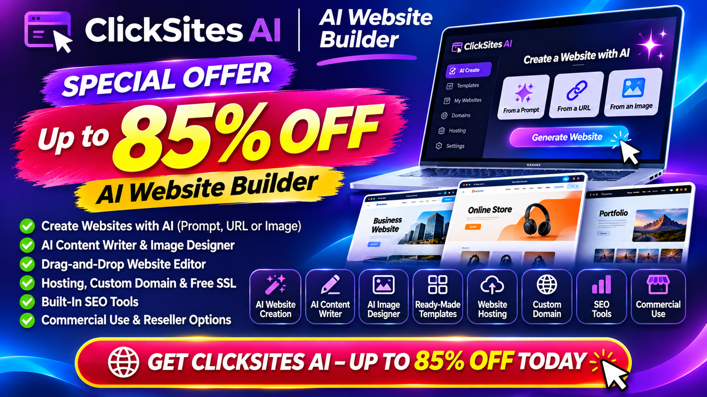

# 🌐 ClickSites AI Promo Code – Get Up to 85% OFF AI Website Builder

---

  **Want to build professional websites without hiring designers or learning how to code?**
   
  Discover ClickSites AI, a website builder that uses artificial intelligence to create, customize, and publish websites from prompts, URLs, or images.

  🔥 **<a href="https://deal.ink/ClickSites">CLAIM YOUR CLICKsites AI DISCOUNT – UP TO 85% OFF</a>**

---

## 📑 Table of Contents

1. [What Is ClickSites AI?](#what-is-clicksites-ai)
2. [How Does ClickSites AI Work?](#how-does-clicksites-ai-work)
3. [ClickSites AI Features](#clicksites-ai-features)
4. [Who Should Use ClickSites AI?](#who-should-use-clicksites-ai)
5. [What Can You Build With ClickSites AI?](#what-can-you-build-with-clicksites-ai)
6. [How to Make Money With ClickSites AI](#how-to-make-money-with-clicksites-ai)
7. [ClickSites AI Pricing and Plans](#clicksites-ai-pricing-and-plans)
8. [ClickSites AI for Beginners – Getting Started](#clicksites-ai-for-beginners--getting-started)
9. [Benefits of Using an AI Website Builder](#benefits-of-using-an-ai-website-builder)
10. [Things to Consider Before Buying](#things-to-consider-before-buying)
11. [Frequently Asked Questions](#frequently-asked-questions)
12. [Get Up to 85% OFF ClickSites AI](#get-up-to-85-off-clicksites-ai)
13. [Final Verdict](#final-verdict)
14. [Affiliate Disclosure](#affiliate-disclosure)

---

## What Is ClickSites AI?

Building a professional website traditionally requires several things: a domain, hosting, a website designer, content, images, and sometimes a developer to customize everything.

For beginners, freelancers, small business owners, and online entrepreneurs, getting all these pieces together can be expensive and time-consuming.

**ClickSites AI is designed to simplify this process.**

It is an AI-powered, no-code website builder that helps users create websites using written prompts, existing URLs, or images.

Instead of starting with a blank page, you can describe the website you want, provide a reference, and let the AI generate an initial design and content.

You can then customize the generated website using AI-assisted editing tools and a drag-and-drop website editor.

ClickSites also advertises features such as:

- AI website creation
- AI content writing
- AI image design
- Website redesigning
- Ready-made website templates
- Drag-and-drop editing
- Custom domain support
- Website hosting
- SSL certificates
- SEO tools
- HTML export
- Commercial usage options

The platform is designed for people who want to build websites without managing multiple separate tools.

Whether you want to create a business website, landing page, portfolio, blog, affiliate website, or client website, ClickSites provides tools to help you get started.

**Want to explore the current promotional deal?**

👉 [Get ClickSites AI – Claim Up to 85% OFF](https://deal.ink/ClickSites)

---

## How Does ClickSites AI Work?

ClickSites offers different ways to create a website, making it easier to start with an idea, an existing website, or a visual reference.

### 1. Create a Website Using a Prompt

Describe the website you want to build.

For example:

"I need a professional website for a Toronto-based cleaning company. Include a homepage, services, about us, customer testimonials, and a contact form. Use a modern design with a clean blue and white colour scheme."

The AI uses your instructions to generate a website layout, content, and visuals.

This is particularly useful if you don't know where to begin with website design.

### 2. Create a Website From an Existing URL

You can provide a website URL as a reference.

ClickSites can analyze the reference and generate a redesigned version that you can customize.

This can be useful when you want to refresh your own existing website or use your own website as a starting point for a new design.

Always respect the intellectual property and usage rights of websites you use as references. Do not copy another business's branding or protected content without permission.

### 3. Create a Website From an Image

ClickSites also advertises an image-based website creation option.

You can use a screenshot or visual reference to help generate a website layout.

This may be helpful if you already have an idea of how you want your website to look but don't know how to build it yourself.

### 4. Customize Your Website

Once the AI generates your website, you can make changes using the available editing tools.

You can adjust:

- Text and headlines
- Images and graphics
- Colours and layouts
- Website sections
- Buttons and links
- Page content
- Overall design

The drag-and-drop editor gives you another way to customize the website without manually writing code.

### 5. Publish Your Website

After reviewing your website, you can publish it using the available hosting options.

ClickSites advertises support for custom domains, subdomains, free SSL, and HTML downloads.

Check your selected plan for the applicable domain, hosting, and export limits.

---

## ClickSites AI Features

ClickSites combines several website creation and editing tools into one platform.

Here are some of its advertised features and how they may be useful.

### 1. AI Website Builder

Generate websites using written prompts, URLs, or images.

This gives users different ways to start a project instead of building every page manually.

### 2. AI Design Studio

ClickSites advertises multiple website creation modes, including AI Design Studio.

This is intended to help users generate website designs based on their ideas and requirements.

### 3. AI Template Creation

Use the available AI template creation options to get started with a website layout.

Templates can help users who prefer a structured starting point rather than creating everything from scratch.

### 4. AI Canvas

ClickSites also advertises an AI Canvas creation mode.

This provides another approach to generating website layouts and designs using AI.

### 5. AI Content Writer

Creating website content can take just as much time as designing the website.

The built-in AI content writer helps generate website copy, headlines, descriptions, and other written content.

You can use it to create initial drafts and then edit the content to match your business, audience, and brand voice.

### 6. AI Image Designer

Websites need visuals to look professional and engaging.

ClickSites includes an AI image design feature that can help create images for website projects.

This can reduce the need to search for every visual separately.

### 7. AI Website Editor Assistant

ClickSites advertises an AI assistant for editing websites.

You can use AI-assisted editing to make changes and improve website content or design.

This may be helpful when you want to make adjustments without manually editing every element.

### 8. One-Click AI Website Redesign

Already have a website but want a fresh look?

The AI website redesign feature is designed to help generate a redesigned layout.

It can be useful for refreshing your own website without starting the entire project manually.

### 9. Drag-and-Drop Website Editor

Not every change requires AI.

ClickSites includes a visual drag-and-drop website editor that allows users to customize website elements and sections.

This provides more direct control over the final design.

### 10. Ready-Made Website Templates and Design Sections

ClickSites advertises ready-made templates and reusable website sections.

These can help you build pages more quickly by starting with existing layouts rather than designing every section yourself.

The number of available sections and templates depends on the selected plan.

### 11. Custom Domain and Subdomain Support

You can use a custom domain or an available subdomain for your website.

A custom domain is especially useful for businesses that want a professional online presence.

### 12. Website Hosting and Free SSL

ClickSites advertises website hosting and free SSL certificates for supported websites.

This can help simplify the process of publishing and maintaining a website.

Review the selected plan's hosting terms and limitations before relying on it for an important business website.

### 13. Download Website HTML

ClickSites advertises the ability to download website HTML.

This can be useful if you prefer to host your website elsewhere or want more control over your hosting arrangements.

Check the export functionality and any limitations before purchasing.

### 14. Built-In SEO Tools

Getting a website online is only the first step. You also need to help people find it.

ClickSites advertises SEO tools designed to help improve website optimization and search visibility.

Remember that SEO results also depend on content quality, competition, technical implementation, backlinks, and ongoing optimization. No website builder can guarantee search rankings.

### 15. Team Collaboration

ClickSites offers team collaboration accounts, with the available number depending on the selected plan.

This can be useful for agencies or businesses where multiple people need access to website projects.

### 16. Webhooks and Third-Party Integrations

The All-Access plan advertises integrations with services such as Zapier and Pabbly, along with webhook functionality and autoresponder integrations.

These connections can help automate workflows and connect website activities with other business applications.

### 17. White-Label and Reseller Options

The All-Access plan advertises white-label accounts and the ability to rebrand and resell the ClickSites application.

This can be interesting for agencies, freelancers, and entrepreneurs who want to offer website-building services under their own brand.

Review the commercial and reseller licence carefully to understand exactly what you can sell and how you can use the software.

---

## Who Should Use ClickSites AI?

ClickSites may be useful for different types of users, particularly those who want to create websites without hiring a designer or developer for every project.

### 1. Beginners and First-Time Website Owners

If you have never built a website before, getting started can feel complicated.

ClickSites provides AI website creation and visual editing tools that can make the process more approachable.

### 2. Small Business Owners

Small businesses need websites to showcase their services, share contact information, display products, and attract customers.

ClickSites may help business owners create their own online presence without starting with a traditional web development project.

### 3. Freelancers and Web Designers

Freelancers can use AI-generated layouts as starting points for client projects.

Instead of building every section from scratch, they can use the generated website and customize it according to the client's requirements.

### 4. Digital Marketing Agencies

Agencies often need landing pages, campaign websites, lead-generation pages, and client websites.

ClickSites' website creation and collaboration features may help support these projects.

### 5. Bloggers and Content Creators

Bloggers can use website-building tools to create niche websites, personal blogs, and content platforms.

You can also use the AI content writer to help develop initial content drafts.

Remember to review and improve AI-generated content before publishing.

### 6. Affiliate Marketers

Affiliate marketers need websites and landing pages to promote products and services.

ClickSites can help create:

- Product review websites
- Comparison pages
- Affiliate landing pages
- Niche websites
- Promotional pages
- Email capture pages

You should always publish useful, original content and clearly disclose affiliate relationships.

### 7. Online Entrepreneurs

If you have an online business idea but don't have website development skills, an AI website builder can help you turn your idea into a working starting point.

### 8. Website Resellers

The advertised All-Access plan includes white-label and reseller-related features.

This may appeal to entrepreneurs who want to build websites for clients or offer website-related services under their own brand.

---

## What Can You Build With ClickSites AI?

The possibilities depend on your business idea, content, and the features available in your selected plan.

Here are some examples.

| Website Type | Possible Purpose |
|---|---|
| Business Website | Showcase a company's services and contact information |
| Landing Page | Promote a product, service, or marketing campaign |
| Portfolio Website | Display professional work and projects |
| Affiliate Website | Publish product reviews and affiliate recommendations |
| Blog | Share articles, tutorials, and educational content |
| Lead Generation Website | Collect inquiries from potential customers |
| E-commerce Landing Page | Introduce products and direct visitors to a purchase page |
| Agency Website | Promote digital marketing and web design services |
| Local Business Website | Help local businesses establish an online presence |
| Personal Website | Build a professional online identity |
| Event Website | Share event information and registration details |
| Digital Product Website | Promote e-books, templates, courses, and downloads |

### Example: Build a Website for a Local Business

Imagine a local landscaping company that needs a professional website.

You could use ClickSites to create a website with:

- Homepage
- Services page
- About us section
- Project gallery
- Customer testimonials
- Contact information
- Quote request form

The AI can help generate an initial design and content, while you customize the final result.

This could save time compared with building every page manually.

---

## How to Make Money With ClickSites AI

One interesting use of an AI website builder is the opportunity to turn website creation into a service.

You don't necessarily need to build websites only for yourself. You can also explore offering website-related services to other businesses.

Here are several business models to consider.

### 1. Freelance Website Design

Create websites for small businesses, professionals, and individuals.

Potential customers include:

- Restaurants
- Cleaning companies
- Contractors
- Real estate agents
- Personal trainers
- Consultants
- Local shops
- Beauty salons

You can charge clients for website creation, customization, and publishing.

### 2. Sell Custom Websites

Build websites for specific industries and sell completed projects to interested businesses.

For example, you could create a website template for a cleaning company and customize it for different customers.

### 3. Offer Website Maintenance Services

Websites need ongoing updates.

You could offer monthly services that include:

- Updating website content
- Changing images
- Adding new services
- Updating business information
- Making design improvements
- Checking website functionality

This can create recurring service revenue if clients agree to an ongoing maintenance arrangement.

### 4. Build Affiliate Marketing Websites

Create niche websites focused on specific products, services, or industries.

You can publish helpful articles and earn commissions by recommending relevant products through affiliate programs.

For example:

- Technology product reviews
- Software comparisons
- Home improvement recommendations
- Online business tools
- Educational resources

Remember that building a website does not automatically generate traffic or sales. You still need useful content, SEO, promotion, and an appropriate affiliate strategy.

### 5. Create Lead Generation Websites

Build websites that attract potential customers for local businesses.

For example, a website focused on home cleaning services could collect inquiries from people looking for cleaning companies.

You may then work with local businesses that want qualified leads.

Make sure your lead collection and sharing practices comply with applicable privacy and consent requirements.

### 6. Create Portfolio Websites

Professionals often need websites to showcase their work.

You could build portfolio websites for:

- Photographers
- Graphic designers
- Writers
- Developers
- Consultants
- Artists
- Freelancers

### 7. Offer White-Label Website Services

The ClickSites All-Access plan advertises white-label and reseller features.

This may allow eligible users to offer website-building services using their own branding, subject to the plan's licence terms.

You could build a business around providing website solutions to other entrepreneurs and companies.

### 8. Sell Digital Products

You can create websites to promote and sell digital products such as:

- E-books
- Templates
- Planners
- Online courses
- Downloadable resources
- Design assets

The website can act as your product landing page and marketing platform.

**Important:** These are potential business models, not guaranteed income opportunities. Your results will depend on your skills, pricing, marketing, customer service, and ability to deliver quality websites.

---

## ClickSites AI Pricing and Plans

ClickSites advertises one-time payment plans rather than mandatory monthly subscriptions.

Its published offer describes two main options.

### Basic Plan

The Basic plan is advertised at a single payment of $49.

It includes features such as:

- Build up to 100 AI-generated websites
- Up to 100 custom domains
- Up to 100 workspaces
- 5 team collaboration accounts
- 50 ready-made design sections
- AI website editor chatbot
- AI content writer
- AI image designer
- One-click AI website redesigning
- AI editing assistant
- Drag-and-drop website editor
- Ready-to-use website templates
- Custom domain or subdomain support
- Website hosting
- Free SSL
- HTML download
- SEO tools
- Commercial use licence

### All-Access Plan

The All-Access plan is advertised at a single payment of $179.

It includes the Basic features, with additional capabilities such as:

- Unlimited AI-generated websites
- Up to 500 custom domains
- Up to 500 workspaces
- 10 team collaboration accounts
- 150 ready-made design sections
- 150 white-label accounts
- Rebrand and resell ClickSites
- Use your own logo and branding
- Webhooks and integrations
- Zapier and Pabbly integrations
- Autoresponder integrations
- Automatic AI layout redesigning
- AI image generation
- AI website content writing
- Unlimited website hosting
- Free SSL
- Custom domain support
- AI SEO tools
- HTML download
- Commercial and reseller licence
- VIP support

### Basic vs All-Access

| Feature | Basic | All-Access |
|---|---:|---:|
| Payment | $49 one-time | $179 one-time |
| AI Websites | 100 | Unlimited |
| Custom Domains | 100 | 500 |
| Workspaces | 100 | 500 |
| Team Accounts | 5 | 10 |
| Design Sections | 50 | 150 |
| White-Label Accounts | Not included in advertised Basic features | 150 |
| Rebrand and Resell | Not included in advertised Basic features | Included |
| Integrations | Limited | Advanced integrations |
| Commercial Use | Included | Included |
| Reseller Licence | Not advertised | Included |

Plan details and prices can change. Review the checkout page to confirm the exact features, usage limits, and licensing terms before purchasing.

---

## ClickSites AI for Beginners – Getting Started

If you're new to website creation, here is a simple approach to getting started.

### Step 1: Decide What Website You Want

Before opening the builder, identify the purpose of your website.

Are you creating:

- A business website?
- A personal portfolio?
- An affiliate website?
- A blog?
- A landing page?
- A website for a client?

Having a clear objective makes it easier to write useful AI prompts.

### Step 2: Prepare Your Website Information

Gather the basic information you want to include.

For a business website, this might include:

- Business name
- Services
- Business description
- Target audience
- Contact information
- Location
- Brand colours
- Logo
- Images

### Step 3: Write a Detailed Prompt

A detailed prompt generally produces a more useful starting point than a very short instruction.

Example:

"Create a modern, professional website for a Toronto-based digital marketing agency. Include a homepage, about section, services, portfolio, testimonials, and contact page. Use a clean layout, professional typography, and a blue and white colour scheme. Make the design mobile-friendly and include clear calls to action."

### Step 4: Review the Generated Website

Don't publish the first version without checking it.

Review:

- Headlines and written content
- Images and graphics
- Contact information
- Buttons and links
- Page layout
- Mobile responsiveness
- Spelling and grammar
- Legal and privacy pages where applicable

### Step 5: Customize the Design

Use the available AI editing and drag-and-drop tools to make improvements.

Make sure the website reflects the actual business or project rather than looking like a generic AI-generated template.

### Step 6: Connect Your Domain

If you want a professional website address, connect your custom domain using the available settings.

Follow the domain configuration instructions and verify that SSL is working correctly.

### Step 7: Publish and Test

Before promoting your website, test it on desktop and mobile devices.

Check that:

- All pages load correctly.
- Navigation works.
- Contact forms function.
- Buttons lead to the correct destinations.
- Images display properly.
- The website is readable on mobile devices.

A website should be tested and reviewed before being used for business or advertising campaigns.

---

## Benefits of Using an AI Website Builder

Traditional website development can involve multiple people, tools, and expenses.

AI website builders aim to simplify parts of that process.

Here are some potential benefits.

### Save Time

AI-generated layouts and content can provide a starting point instead of creating every element manually.

### Reduce Initial Design Costs

You may not need to hire a designer for every basic website project.

However, complex or specialized websites may still require professional design and development.

### Build Without Coding

Visual editing tools make website customization more accessible to people without programming experience.

### Create Multiple Website Projects

Depending on the plan, you can use ClickSites to create multiple websites for different businesses or projects.

### Generate Initial Website Content

The AI content writer can help produce first drafts for headlines, descriptions, and website sections.

You should always review and edit the output for accuracy and originality.

### Manage Website Projects in One Platform

Combining website generation, editing, hosting, and other tools can reduce the need to manage several separate services.

### Explore Business Opportunities

Freelancers, agencies, and entrepreneurs can use website-building tools to explore services such as web design, landing-page creation, and website maintenance.

---

## Things to Consider Before Buying

ClickSites offers a range of website-building features, but it's important to understand what an AI website builder can and cannot do.

### 1. AI-Generated Websites Need Human Review

AI can create a starting design and content, but it doesn't automatically understand every business requirement.

Review all content, images, links, forms, and page layouts before publishing.

### 2. SEO Requires More Than a Tool

Built-in SEO features can help with optimization, but they do not guarantee Google rankings.

You still need quality content, keyword research, technical SEO, useful pages, and ongoing improvements.

### 3. Check Hosting and Domain Limits

Review the selected plan to understand the number of domains, workspaces, websites, and hosting features included.

### 4. Understand the Reseller Licence

If you intend to build websites for clients or resell the platform, read the commercial and reseller licence carefully.

### 5. Check Third-Party Integrations

Some integrations may require separate accounts or subscriptions with external services.

Confirm any additional costs before relying on them.

### 6. Review the Final Checkout Price

The promotional discount, selected plan, taxes, and other checkout details can affect the final amount.

Always confirm the total before purchasing.

---

## Frequently Asked Questions

### 1. What is ClickSites AI?

ClickSites AI is an AI-powered, no-code website builder that helps users create, edit, and publish websites using prompts, URLs, and images.

### 2. Do I need coding skills to use ClickSites?

No. ClickSites is designed for users without programming experience. It provides AI website creation and a visual drag-and-drop editor.

### 3. Can ClickSites create a website from a prompt?

Yes. You can describe the website you want, and its AI tools can generate an initial website design and content.

### 4. Can I create a website from an existing URL?

Yes. ClickSites advertises URL-based website creation and redesigning capabilities.

### 5. Can I create a website from an image?

Yes. The platform advertises an image-based website creation option that can use a visual reference to generate a website layout.

### 6. Does ClickSites include website hosting?

Yes. ClickSites advertises website hosting, custom domain support, subdomains, and free SSL for supported websites.

Check your selected plan for the applicable limits and terms.

### 7. Can I use my own domain?

Yes. ClickSites advertises support for custom domains as well as subdomains.

### 8. Can I download my website?

ClickSites advertises an HTML download option. Review the export functionality and any applicable limitations before purchasing.

### 9. Does ClickSites include AI content writing?

Yes. The platform advertises a built-in AI content writer to help generate website copy.

### 10. Does ClickSites include AI image generation?

Yes. ClickSites advertises an AI image designer and automated AI image generation features.

### 11. Can I create websites for clients?

The advertised commercial licence allows commercial website use. The All-Access plan also advertises reseller and white-label features.

Review the specific licence terms before offering services to clients.

### 12. Can I resell ClickSites under my own brand?

The All-Access plan advertises white-label accounts and the ability to rebrand and resell the application.

Check the licence for the exact permissions and restrictions.

### 13. Does ClickSites charge monthly fees?

The published offer advertises one-time payment plans without mandatory monthly software fees.

Check the current checkout terms for any optional services or third-party costs.

### 14. What is the difference between Basic and All-Access?

The Basic plan is advertised for up to 100 AI websites, while All-Access offers unlimited AI websites and additional features such as white-label accounts, reseller options, and advanced integrations.

### 15. Does ClickSites offer a money-back guarantee?

The published offer advertises a 30-day money-back guarantee. Review the current refund policy and eligibility conditions before purchasing.

### 16. Is ClickSites suitable for affiliate marketing?

It can be used to create affiliate websites, landing pages, and niche content sites.

However, success depends on useful content, traffic generation, SEO, and a suitable affiliate marketing strategy.

### 17. Can beginners make money using ClickSites?

Beginners can explore website-related services such as freelance web design, landing-page creation, and website maintenance.

However, buying the software does not guarantee customers or income. You still need to develop your skills, find clients, and deliver quality work.

### 18. How can I get the ClickSites AI discount?

Use the promotional link below to explore the current offer and check the available discount.

[Claim Up to 85% OFF ClickSites AI](https://deal.ink/ClickSites)

---

## Get Up to 85% OFF ClickSites AI

If you've been thinking about starting a website, building an online business, or offering website creation services to clients, ClickSites AI may be worth exploring.

Its combination of AI website generation, content writing, image design, visual editing, hosting, and commercial usage options provides several ways to approach website creation.

The All-Access plan may be particularly interesting for freelancers, agencies, and entrepreneurs who want the advertised white-label and reseller capabilities.

### Claim Your ClickSites AI Discount

🔥 **[GET CLICKsites AI – CLAIM UP TO 85% OFF](https://deal.ink/ClickSites)**

Check the current promotional offer, compare the available plans, and confirm the final checkout price before purchasing.

---

## Final Verdict

ClickSites AI aims to make website creation more accessible by combining AI-powered design, content generation, website editing, and publishing tools in one platform.

For beginners, it provides different ways to create a website without needing to learn traditional web development.

For freelancers and agencies, its commercial and advertised reseller features may offer opportunities to build websites for clients and develop additional services.

For online entrepreneurs and affiliate marketers, it can provide a starting point for building niche websites, landing pages, and promotional projects.

However, the quality of the final website still depends on your instructions, content, customization, and testing. AI-generated websites should always be reviewed before publishing.

If you want to explore an AI website builder and take advantage of the advertised promotional offer, ClickSites AI is worth checking out.

🚀 **[EXPLORE CLICKsites AI – SAVE UP TO 85% TODAY](https://deal.ink/ClickSites)**

---

## Affiliate Disclosure

This article contains an affiliate link to ClickSites AI.

If you purchase through the link provided in this article, I may earn a commission at no additional cost to you.

The purpose of this guide is to help readers understand ClickSites AI, its website-building features, potential use cases, pricing options, and limitations before making a purchasing decision.

Product features, plan limits, pricing, licensing terms, and promotional discounts may change. Always review the latest offer and terms before completing your purchase.
